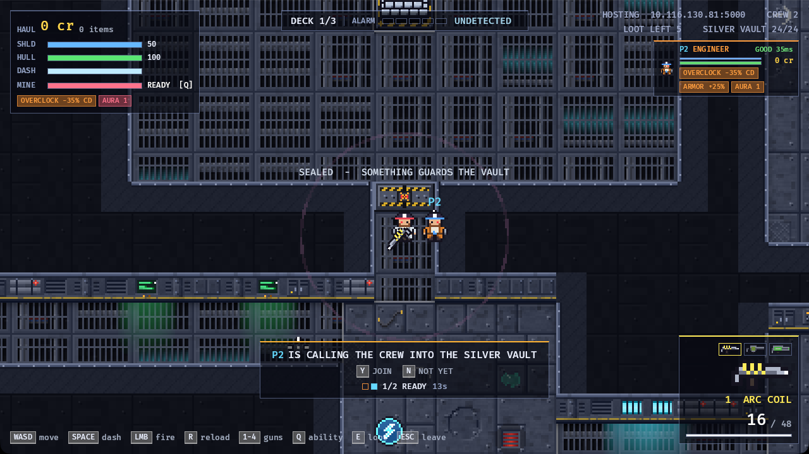
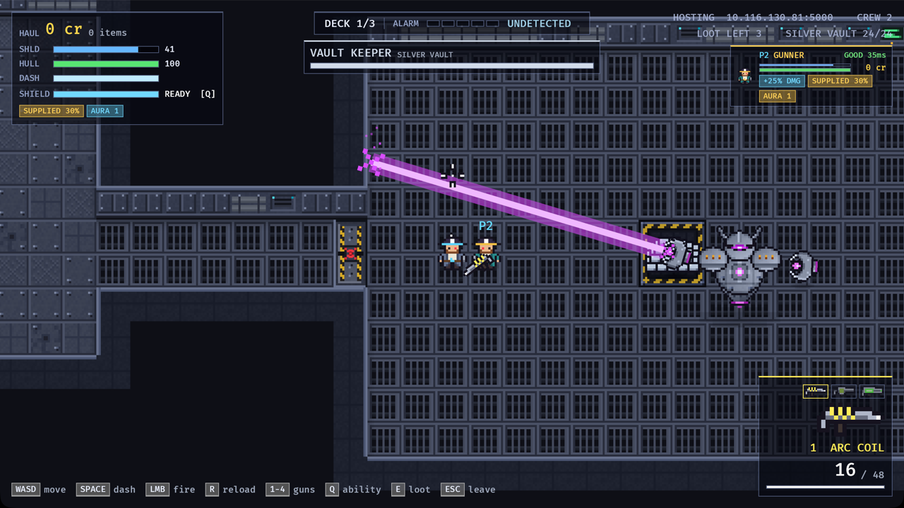
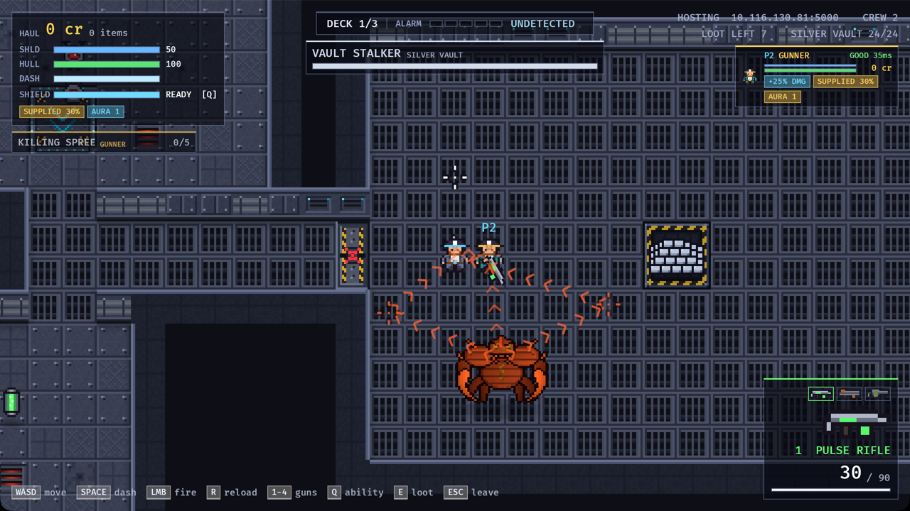
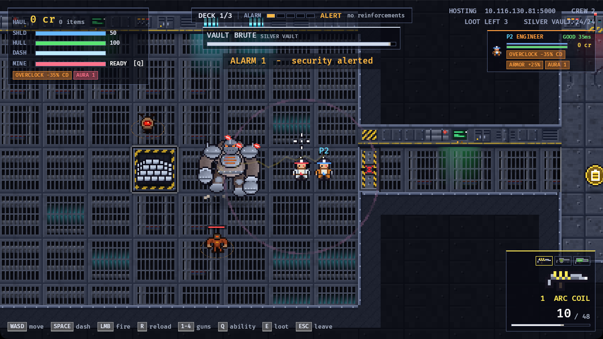

# DOZD


A co-op space-pirate heist game. Loot a station three decks deep, crack each
deck's vault, ride the lift down to richer ones, and get out on a hazard pad
before security overwhelms you.

## Decks

Each deck down is harder than the last: more rooms, more guards in each, and
nastier ones, and once the alarm is up, reinforcements come faster, in bigger
waves, and with more of the heavy guards.

Every deck's main room holds a vault, and the deeper it is, the richer:

| Deck | Vault | Bars | Each | Total |
|---|---|---|---|---|
| 1 | Silver | 24 | 150 cr | 3,600 cr |
| 2 | Gold | 32 | 310 cr | 9,920 cr |
| 3 | Platinum | 40 | 560 cr | 22,400 cr |

Each vault room is sealed off from the rest of the deck behind a gate, and a
boss waits inside. Step up to the gate and you call the crew
in: every living crewmate on the deck has to press Y to join you (N turns it
down, and the call lapses after 20 s). Once all have said yes, the whole crew
is let in together and the gate locks behind you until the boss is down. You
can't see the boss from outside its room.

Three kinds of boss take turns down the decks, so every heist meets each once:

- **Vault Keeper:** fights with two floating hands. Each hand either sweeps a
  laser across where you stand, after a warning line shows where it'll burn, or
  gathers a nova orb in its palm and hurls it, arcing at whoever it passes and
  bursting on impact. Enraged, both hands attack at once and faster, lasers
  sweep wider and novas come in threes.
- **Vault Stalker:** a hulking stalker. Every 2-3 s it crouches and lays out
  three possible lunge routes (four enraged), each through up to three pirates
  or feinting into open floor first. Only when it goes does it pick one, at
  random, and lunge along it, hitting hard and throwing pirates aside. Now and
  then it rampages instead: it rears up, then dashes wall to wall across the
  room four times (six enraged), bracing at the wall between dashes with the
  next lane showing. A dash does massive damage. It stands spent for a moment
  after either attack. Step off every route it shows, and out of the lane.

- **Vault Brute:** a beefy, armoured brute with the most health of the three.
  It only fights up close: it plods after you, raises its fists over a spot
  just in front of it, then slams it, hitting everyone in the circle hard.
  Every 12 s (9 s enraged, and once as it enrages) it roars and calls in
  guards to fight for it, a mix of every kind, all enraged as if by a Herald's war cry, more the bigger the crew and
  more again enraged; their spots glow while it roars. Summoned guards drop
  ammo but never credits, and they all fall with the Brute, except any a Hacker turned: those fight on, still enraged.

A boss has a lot of health, more for a bigger crew, and enrages below half
health. Each one further down has more health and hits harder, and the last
deck's is deliberately overtuned. A raised riot shield blocks all of their
attacks, lasers, orbs, arcs, blasts and slams alike (a blast in front of its holder never reaches round it), and stops a lunge dead,
staggering the stalker; it ends a rampage too. Hacks, Blackout and shock fields don't touch them, but a Hacker's jamming does: a jammed boss's hits may whiff.
When a boss falls it drops a bounty, some ammo and a Nano Patch, and the gate
opens for good.

Only then can the vault be looted. Stand at it and hold E to pull bars out one at a time, about one every 1.2 s.
Every pirate at the vault pulls on their own, so a full crew empties it far
faster than one pirate. Firing, using your ability (a laser or riot shield
held out included) or stepping away starts the bar you're pulling over; a
sentry you dropped first keeps shooting for you. The first bar out breaches the vault: the station goes into lockdown and
sends a wave straight away, and every bar after raises the alarm a little.

The lift down only goes once the whole crew still in the heist is aboard.

## Getting out

Every deck has a pad. Hold it for 15 s and the pirates standing on it get out;
everyone else stays in and the heist goes on.

- **Leaving early** while crewmates stay in: you keep exactly what you looted,
  whatever happens to the crew.
- **The crew getting out** (the last pirates still in leave together): they pool
  what they carry, add a bonus of 25% of the pool for every pirate who left
  early, and split it evenly.
- **The crew dying:** everyone still in loses everything. Pirates who left
  early keep theirs.

## Challenges

About 10 s after the crew reaches a deck, the station may set challenges. Each
has a goal, lasts for the whole heist, one deck or a set time, and is for the
whole crew or one class. Completing it earns a reward, for whoever completed
it or for the whole crew. Open challenges and running rewards show under the
top-left panel. Each disappears once it's completed or failed. A streak's
clock starts with its first kill: if it runs out short of the goal, the
challenge fails.

| Challenge | For | Goal | Lasts | Reward |
|---|---|---|---|---|
| Killing Spree | Gunner | Kill 5 guards within 15 s | That deck | +30% damage for 45 s |

New challenges go in `catalog` in `src/challenge.rs`.

Built with Rust and [Bevy](https://bevyengine.org/); LAN multiplayer uses
[bevy_replicon](https://github.com/projectharmonia/bevy_replicon).

> [!IMPORTANT]
> This project has been developed entirely by Claude Opus 5.5 and is a
> prototype. I want to figure out the game itself before starting to write it
> myself.

## Screenshots

| | |
| --- | --- |
|  |  |
| The main menu | Picking a class, abilities and guns: here the Hacker with Blackout |
|  |  |
| The crew lobby: one of each class, picked by whoever took it | The perks lying around each deck, under **EXTRAS** |
|  |  |
| Two pirates pulling bars out of deck 2's gold vault in lockdown, with guards closing in | The last pirate out takes the crew's pool, plus a bonus for the crewmate who left early |
|  |  |
| A crewmate calls the crew into the sealed vault: everyone has to press Y | The Vault Keeper sweeping a laser past the crew |
|  |  |
| The Vault Stalker winding up: three ways it might lunge, and only it knows which | The Vault Brute roaring guards in, one more appearing at the glowing spot |
|  | |
| The station's guards and vault bosses, under **EXTRAS** in the main menu | |

## Run

```sh
cargo run --release                    # main menu
cargo run --release -- solo            # straight into a solo run
cargo run --release -- host [port]     # host a LAN game (default port 5000)
cargo run --release -- join <address>  # join a host, e.g. 192.168.1.20 or host:5000
```

Release builds embed all assets, so `target/release/dozd` is a single file you
can hand to friends.

While developing, `cargo run --features dev` links Bevy dynamically so rebuilds
after an edit are much faster. Leave it off for builds you share.

## Builds

`tools/package.sh windows|macos|linux` builds a release for that platform and
packs it into `dist/`:

| Platform | Package | Holds |
| --- | --- | --- |
| Windows | `dozd-<version>-windows-x86_64.zip` | `DOZD.exe` |
| macOS | `dozd-<version>-macos.zip` | `DOZD.app`, one app for Apple Silicon and Intel, macOS 11+ |
| Linux | `dozd-<version>-linux-x86_64.tar.gz` | `dozd` |

The macOS app needs both Rust targets (`rustup target add aarch64-apple-darwin
x86_64-apple-darwin`). From a Mac, Windows builds cross-compile with
[cargo-xwin](https://github.com/rust-cross/cargo-xwin):
`CARGO_BUILD="cargo xwin build" tools/package.sh windows`.

GitHub Actions builds all three: run **Release** from the Actions tab to get
them as artifacts, or push a version tag (`git tag v0.2.0 && git push origin
v0.2.0`) to also publish them as a GitHub release.

The macOS app isn't notarized, so the first launch is blocked until it's
allowed under System Settings > Privacy & Security > **Open Anyway**, and Windows may warn about an unknown publisher (**More info** >
**Run anyway**). On Windows, the release build has no console, so
`headless` prints nothing there; use a debug build for it.

## Pirates

Pick a class, its abilities and your guns under **LOADOUT** in the main menu
before a raid. Each class picks one passive ability, always on, and one active
ability on Q, from the ones it offers. Every pirate carries 3 guns, in the
order you pick them.

Passives show as chips under your bars and on each crewmate's card, alongside
a Doctor's ward.

Online, a crew holds at most one of each class, so up to 5 pirates. Host or
join one under **MULTIPLAYER**. Hosting opens a lobby where everyone picks a
free class, their abilities and their guns, then the host starts the run;
after each run the crew returns to the lobby. Someone joining mid-run picks
from the classes still free.

| Class | Passives | Actives (Q) |
| --- | --- | --- |
| Gunner | **Supply:** they and every crewmate, wherever they are, have a 30% chance for a shot not to use up ammo. **Ricochet:** a bullet that hits a guard has a 30% chance to bounce on into the 2 guards nearest it, for 60% of its damage | **Spare gun:** no Q, but carries a 4th gun. **Laser:** fires a beam for 3 s that cuts through every guard in its path until it reaches a wall, killing even the toughest in under a second (25 s cooldown). It kicks, so the beam shakes off your aim, you walk at under half speed and can't fire your guns while it's on, and guards hear it |
| Engineer | **Overclock:** for every crewmate, the Engineer included, wherever they are: abilities and dashes recharge 35% sooner (the riot shield's charge too), shields start refilling 35% sooner after a hit and refill in 35% less time, and the crew's sentries fire 35% faster | **Sentry gun:** drops a gun that shoots guards for 20 s (25 s cooldown). Guards shoot back at it. Q next to it picks it back up, taking time off the cooldown for the time it had left |
| Bulwark | **Rally:** they and every crewmate within reach deal 25% more damage. **Armour:** 80% more shield | **Riot shield:** raises or lowers a shield you carry in front of you, turning as you aim. No shot gets through, from either side, and you can't fire while holding it. It drains while up (10 s from full) and recharges while down (22 s from empty) |
| Hacker | **Jamming:** guards and vault bosses within reach are jammed: 35% of a guard's shots go wide and its blows whiff, and 35% of a boss's hits whiff | **Hack:** Q brings up a small circle around your crosshair, and a left click turns every guard in it to the crew's side for good, so every hack adds to the guards fighting for you (30 s cooldown). Hacked guards stick with the pirate nearest them, fight whatever comes near the crew, vault bosses included, and follow the crew through the vault gate and down the lift to the next deck. An enraged guard stays enraged once hacked. Q again or a right click calls it off. **Blackout:** freezes every guard on the deck for 4 s, even ones arriving during it, cutting off whatever attack they were winding up (40 s cooldown) |
| Doctor | **Field medic:** slowly heals crewmates within reach. **Lifesteal:** they and every crewmate, wherever they are, have a 50% chance for a hit on a guard to heal them half the damage dealt (sentry shots don't count) | **Ward:** wards crewmates nearby and the Doctor against all harm for 4 s (28 s cooldown). **Leech mine:** plants a mine at your feet that arms in 0.8 s and goes off when a guard or awake vault boss comes close, blasting every guard it can see nearby for up to 110 damage (half that to a boss) and healing every pirate in the crew, wherever they are, 40% of the damage it dealt (lifesteal doesn't add to it) (14 s cooldown; up to 3 down at once, a 4th replaces the oldest) |

## Controls

| Key | Action |
| --- | --- |
| WASD / arrows | Move |
| Mouse | Aim |
| Left click | Fire |
| Space | Dash |
| R | Reload |
| 1-4 / wheel | Switch gun |
| Q | Class ability (Hack: Q to aim, left click to hack) |
| E | Take loot; hold at the vault to pull bars |
| Y / N | Join / turn down a crewmate's call to breach the vault |
| Enter | Play again (results screen) |
| Esc | Leave / back |

## Headless

Runs the game with no window, rendering or input, many times faster than real
time. Bots play the pirates, and every run is reproducible from its seed.

```sh
cargo run --release -- headless --seed 1 --runs 20
```

Options: `--seed N`, `--runs N`, `--crew 1-8`,
`--class gunner|engineer|bulwark|hacker|doctor|mixed` (bots' class; mixed rotates),
`--passive NAME` and `--active NAME` (e.g. `ricochet`, `riotshield`; for the bots whose class has it), `--bot random|idle`,
`--time SECS` (per-run limit), `--hz N` (steps per game second).

## Development

```sh
cargo test
cargo clippy
python3 tools/gen_assets.py   # regenerate the pixel-art sprites in assets/
```

Game rules live in each module's main plugin (`GamePlugins`); sprites, HUD,
menus and input live in its `*ViewPlugin` (`ViewPlugins`), which headless mode
leaves out.
