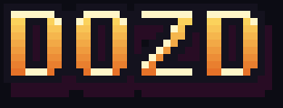
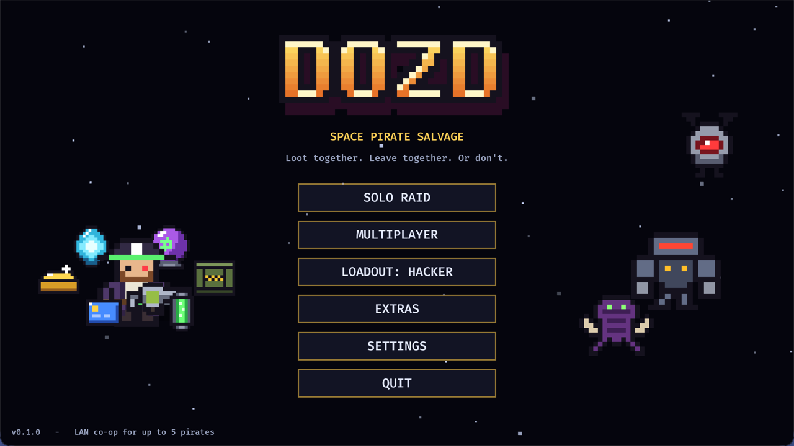
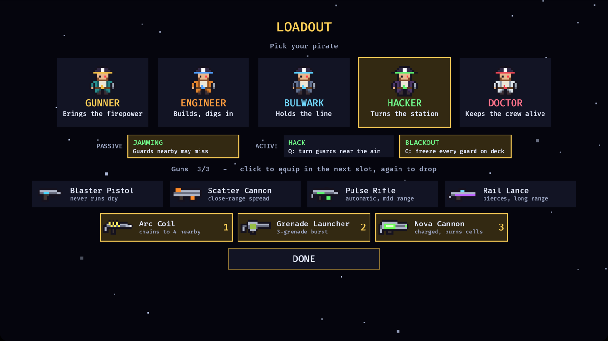
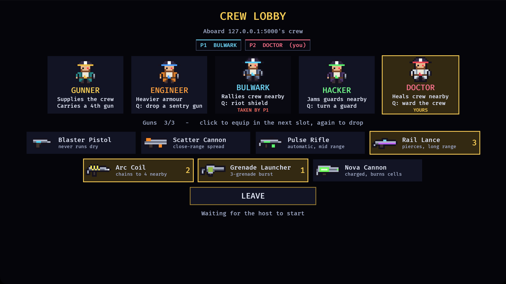
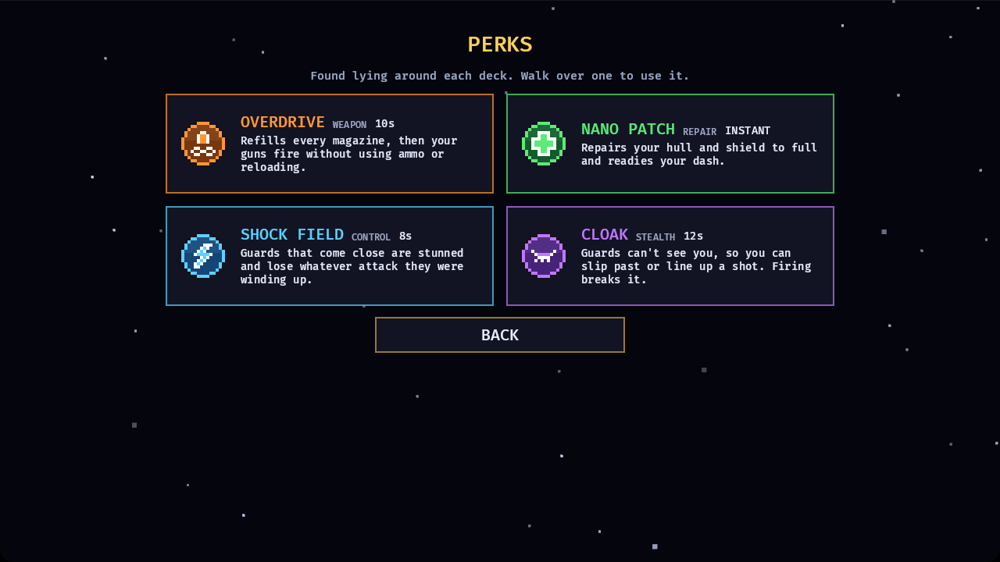
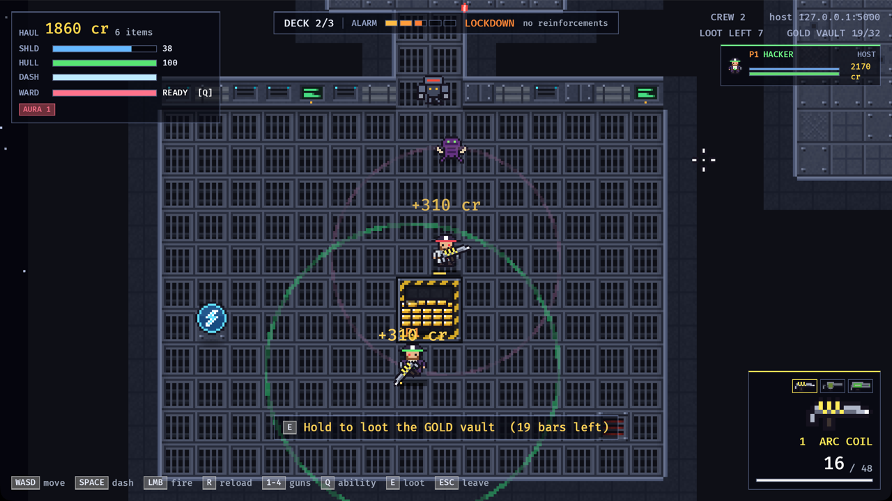
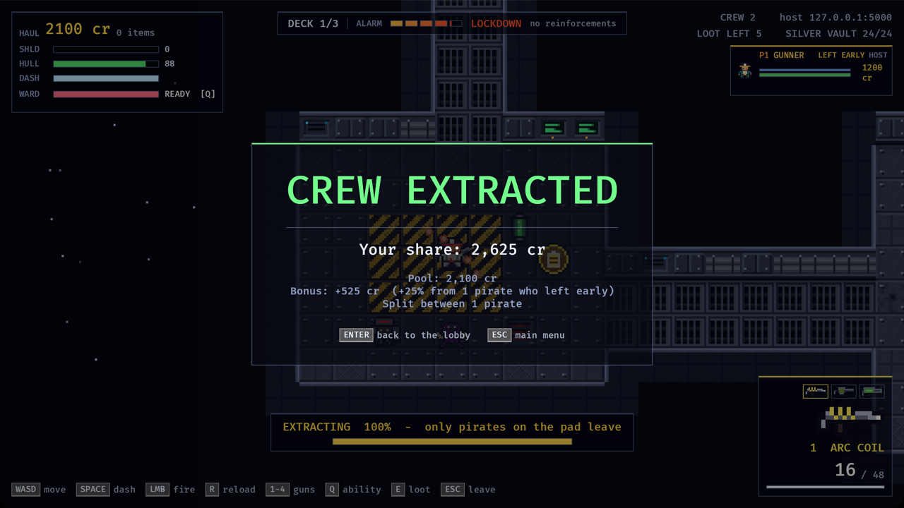
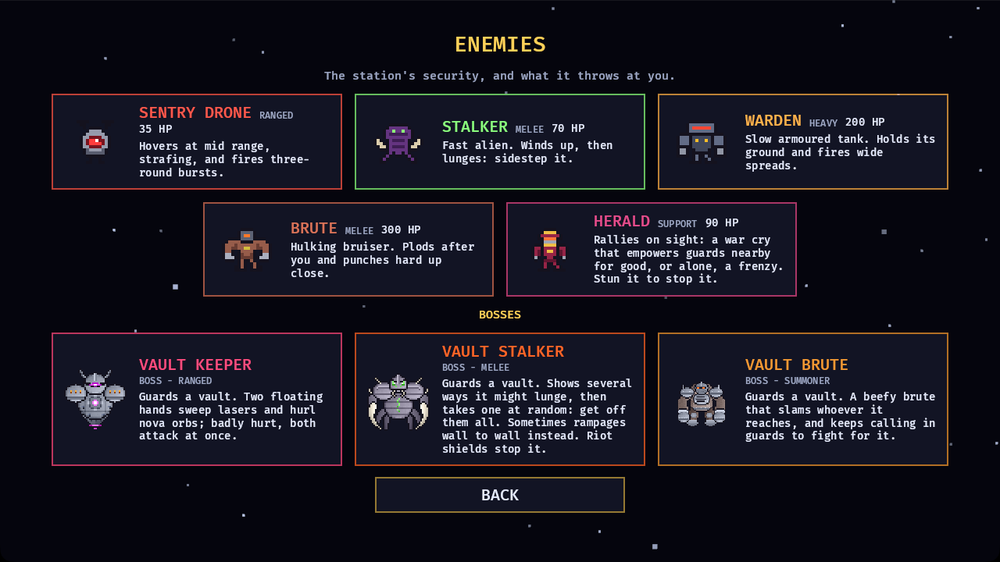

# DOZD



A co-op space-pirate heist game. Loot a station three decks deep, ride the lift
down to richer decks, crack the vault at the bottom, and get out on a hazard pad
before security overwhelms you. Only the pirates standing on the pad when it
finishes get out.

## Decks

Each deck down is harder than the last: more rooms, more guards in each, and
nastier ones, and once the alarm is up, reinforcements come faster, in bigger
waves, and with more of the heavy guards.

The last deck's main room holds the vault: 40 gold bars worth 300 cr each.
Stand at it and hold E to pull bars out one at a time, about one every 1.2 s.
Every pirate at the vault pulls on their own, so a full crew empties it far
faster than one pirate. Firing or stepping away starts the bar you're pulling
over. The first bar out breaches the vault: the station goes into lockdown and
sends a wave straight away, and every bar after raises the alarm a little.

Built with Rust and [Bevy](https://bevyengine.org/); LAN multiplayer uses
[bevy_replicon](https://github.com/projectharmonia/bevy_replicon).

> [!IMPORTANT]
> This project has been developed entirely by Claude Opus 5.5 and is a
> prototype. I want to figure out the game itself before starting to write it
> myself.

## Screenshots

| | |
| --- | --- |
|  |  |
| The main menu | Picking a class, abilities and guns |
|  |  |
| The crew lobby: one of each class, picked by whoever took it | The perks lying around each deck, under **EXTRAS** |
|  |  |
| A Gunner's laser kicking off their aim beside a Bulwark, with each other's status in the crew panel | A crew that didn't make it out |
|  | |
| The station's guards, under **EXTRAS** in the main menu | |

## Run

```sh
cargo run --release                    # main menu
cargo run --release -- solo            # straight into a solo run
cargo run --release -- host [port]     # host a LAN game (default port 5000)
cargo run --release -- join <address>  # join a host, e.g. 192.168.1.20 or host:5000
```

Release builds embed all assets, so `target/release/dozd` is a single file you
can hand to friends.

## Builds

`tools/package.sh windows|macos|linux` builds a release for that platform and
packs it into `dist/`:

| Platform | Package | Holds |
| --- | --- | --- |
| Windows | `dozd-<version>-windows-x86_64.zip` | `DOZD.exe` |
| macOS | `dozd-<version>-macos.zip` | `DOZD.app`, one app for Apple Silicon and Intel, macOS 11+ |
| Linux | `dozd-<version>-linux-x86_64.tar.gz` | `dozd` |

The macOS app needs both Rust targets (`rustup target add aarch64-apple-darwin
x86_64-apple-darwin`). From a Mac, Windows builds cross-compile with
[cargo-xwin](https://github.com/rust-cross/cargo-xwin):
`CARGO_BUILD="cargo xwin build" tools/package.sh windows`.

GitHub Actions builds all three: run **Release** from the Actions tab to get
them as artifacts, or push a version tag (`git tag v0.2.0 && git push origin
v0.2.0`) to also publish them as a GitHub release.

The macOS app isn't notarized, so the first launch is blocked until it's
While developing, `cargo run --features dev` links Bevy dynamically so rebuilds
after an edit are much faster. Leave it off for builds you share.

allowed under System Settings > Privacy & Security > **Open Anyway**, and Windows may warn about an unknown publisher (**More info** >
**Run anyway**). On Windows, the release build has no console, so
`headless` prints nothing there; use a debug build for it.

## Pirates

Pick a class, its abilities and your guns under **LOADOUT** in the main menu
before a raid. Each class picks one passive ability, always on, and one active
ability on Q, from the ones it offers. Every pirate carries 3 guns, in the
order you pick them.

Passives show as chips under your bars and on each crewmate's card, alongside
a Doctor's ward.

Online, a crew holds at most one of each class, so up to 5 pirates. Host or
join one under **MULTIPLAYER**. Hosting opens a lobby where everyone picks a
free class, their abilities and their guns, then the host starts the run;
after each run the crew returns to the lobby. Someone joining mid-run picks
from the classes still free.

| Class | Passives | Actives (Q) |
| --- | --- | --- |
| Gunner | **Supply:** they and every crewmate, wherever they are, have a 30% chance for a shot not to use up ammo. **Ricochet:** a bullet that hits a guard has a 30% chance to bounce on into the 2 guards nearest it, for 60% of its damage | **Spare gun:** no Q, but carries a 4th gun. **Laser:** fires a beam for 3 s that cuts through every guard in its path until it reaches a wall, killing even the toughest in under a second (25 s cooldown). It kicks, so the beam shakes off your aim, you walk at under half speed and can't fire your guns while it's on, and guards hear it |
| Engineer | **Armour:** 80% more shield | **Sentry gun:** drops a gun that shoots guards for 20 s (25 s cooldown). Guards shoot back at it. Q next to it picks it back up, taking time off the cooldown for the time it had left |
| Bulwark | **Rally:** crewmates within reach deal 25% more damage | **Riot shield:** raises or lowers a shield you carry in front of you, turning as you aim. No shot gets through, from either side, and you can't fire while holding it. It drains while up (10 s from full) and recharges while down (22 s from empty) |
| Hacker | **Jamming:** guards within reach are jammed: 35% of their shots go wide and their blows whiff | **Hack:** turns every guard within a small circle around your crosshair, shown while it's ready, to the crew's side for 20 s (30 s cooldown). **Blackout:** freezes every guard on the deck for 4 s, even ones arriving during it, cutting off whatever attack they were winding up (40 s cooldown) |
| Doctor | **Field medic:** slowly heals crewmates within reach. **Lifesteal:** they and every crewmate, wherever they are, have a 30% chance for a hit on a guard to heal them half the damage dealt (sentry shots don't count) | **Ward:** wards crewmates nearby and the Doctor against all harm for 4 s (28 s cooldown) |

## Controls

| Key | Action |
| --- | --- |
| WASD / arrows | Move |
| Mouse | Aim |
| Left click | Fire |
| Space | Dash |
| R | Reload |
| 1-4 / wheel | Switch gun |
| Q | Class ability |
| E | Take loot; hold at the vault to pull gold bars |
| Enter | Play again (results screen) |
| Esc | Leave / back |

## Headless

Runs the game with no window, rendering or input, many times faster than real
time. Bots play the pirates, and every run is reproducible from its seed.

```sh
cargo run --release -- headless --seed 1 --runs 20
```

Options: `--seed N`, `--runs N`, `--crew 1-8`,
`--class gunner|engineer|bulwark|hacker|doctor|mixed` (bots' class; mixed rotates),
`--passive NAME` and `--active NAME` (e.g. `ricochet`, `riotshield`; for the bots whose class has it), `--bot random|idle`,
`--time SECS` (per-run limit), `--hz N` (steps per game second).

## Development

```sh
cargo test
cargo clippy
python3 tools/gen_assets.py   # regenerate the pixel-art sprites in assets/
```

Game rules live in each module's main plugin (`GamePlugins`); sprites, HUD,
menus and input live in its `*ViewPlugin` (`ViewPlugins`), which headless mode
leaves out.
